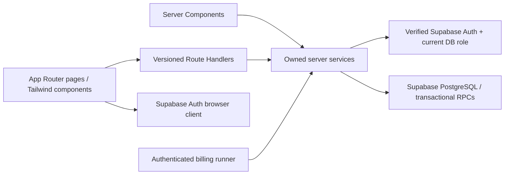

# Hack26 architecture

## Source, scope and decisions

Source: [Subscription Management System](Subscription_Management_System.pdf),
four pages, read 2026-10-31. The brief describes Brightloop's single subscription
business: admin configuration, limited internal staff, customer self-service,
quotes, recurring billing, tax/discount rules, payments and filtered reporting.
The target is page response under two seconds with thousands of subscriptions.

Repository inspection: Next.js 16.4.3, React 19.3, strict TypeScript and Tailwind 4;
only the starter page/layout/styles exist. No existing Auth, database, routes,
service implementation or tests were found in tracked application source. The
graph had no source symbols, so findings were verified by direct file inspection.
Keep those starter files intact. Supabase libraries are not installed in this
baseline; D1 installs pinned `@supabase/supabase-js` and `@supabase/ssr` when building
Auth, committing the lockfile. Do not install a second backend or ORM now.

Decision: one modular Next.js application, one Supabase PostgreSQL database, one
merchant. A customer account is one Auth user and owns its subscriptions/invoices;
company seats and multiple merchants require a later additive membership model.
Use three business roles: `admin`, `internal`, `customer`. D1-D4 are developer
assignments, not runtime roles. Names can be assigned in the workstream document.

Alternatives considered: independent backend services add deployment/auth and
transaction boundaries for four people; browser-controlled financial writes put
business authorization and atomic billing at risk. The chosen server services and
PostgreSQL transactions keep one clear owner for every invariant.

Delivered now: shared instructions, contracts, relational schema, read-access
policies, Auth profile bootstrap, update versioning, and executable schema tests.
The API paths and service functions below are agreed implementation targets, not
live features. No hosted database is changed by this commit.

## Runtime boundaries

- Pages live in `src/app`; business code lives in `src/modules/{identity,catalog,
  subscriptions,billing}`. Public module exports are `contracts.ts` (safe types)
  and `service.ts` (server-only functions). Cross-module imports use only these
  files. No generic repository interface, event bus or parallel REST backend.
- Route Handlers in `src/app/api/v1` validate transport input, verify session,
  enforce role/ownership through services, and map errors to the common envelope.
  Server Components call the same services directly; do not fetch our own HTTP
  server. Client Components use HTTP contracts. No business rules in components.
- All sensitive clients/services import `server-only`. Read under the user's
  cookie/JWT with RLS where possible. For writes, the verified actor's current
  role and resource ownership are checked before using a server secret client.
  Service-role writes bypass RLS; only owned services may create that client.
- PostgreSQL `CHECK`, FK, unique indexes and RLS protect data shape and access.
  D1 lands narrowly granted transactional RPC migrations requested by D2-D4 for
  multi-row writes. They use `SECURITY INVOKER`, are callable by `service_role`
  only, and enforce invariants inside the transaction. Never expose a privileged
  RPC to `anon` or `authenticated` just to fix a permission error.
- Plain catalog updates may use one conditional database statement. Creation of
  subscriptions plus lines, invoice generation/confirmation, recording payments
  and discount redemption must use a single transactional RPC before release.
  Those workflow RPCs are intentionally not implemented by this baseline.

## Authentication and permissions

Supabase Auth owns unique email accounts, password hashes, verified sessions,
email confirmation, reset links and staff invitations. Password policy is length
>= 9, upper/lowercase and special character; the selected built-in Supabase
policy additionally requires a digit. UI/help text must disclose that requirement.
Configure hosted Auth to match
`supabase/config.toml`; SQL migrations do not configure hosted Auth. Disable
anonymous sign-in. Reset requests return the same response for unknown email;
redirect only to configured local/production callback URLs. No open redirects.

`public.users.id = auth.users.id`. A private trigger creates every new profile as
`customer`, regardless of metadata. Resolve current role/active flag from the DB
for each operation; a disabled account is denied even with an unexpired token.
Verify the user using the supported server Auth verification API (`getUser`, not
an unchecked `getSession` result). Token-refresh proxy is a convenience, not the
authorization boundary. Only an admin service can invite/promote staff. The first
admin is an out-of-band, audited operator action after a verified signup, never
an email-name convention, seed password or public promotion endpoint. Invitations
start as customers; promote only after checking the inviter is still an admin.

| Capability | Admin | Internal staff | Customer |
|---|---|---|---|
| Invite staff, change role/active flag | Yes | No | No |
| Products, variants, plans, taxes, discounts, templates | Configure | Read | Safe active catalog DTO only |
| Customer profile directory | All | Read | Own profile only |
| Draft/quote/confirm subscriptions | All | All | No; own portal requests use dedicated actions |
| Activate, pause, resume, close, renew | All | Per plan rules | Own only, per plan rules |
| Generate/confirm/cancel/send/print invoices | All | All | Read/print own issued invoices |
| Record verified received payments | Yes | Yes | No |
| Reports | All | All | No |

Initial database grants are stricter than future HTTP permissions: all browser
writes are denied, including admin writes. Staff read all business rows. Customers
read only their profile, own non-draft subscriptions and lines, issued invoices
(non-null `issued_at` and confirmed/paid/cancelled status)/lines and their recorded
payments. A cancelled draft was never issued and stays staff-only. Products include
private cost/notes, so customers receive filtered DTOs through server services,
not table grants. Staff capability changes require a contract update, not a new
client-side button alone. RLS is enabled even on tables with no browser grants.

## Domain lifecycle

Persist lowercase status strings; show title case in UI. Allowed edges below are
service requirements. Initial migration checks valid status values, not workflow
edges; each owning module must implement and test edges in its transactional RPC
before exposing mutation routes. No generic `PATCH status` endpoint.

| Entity | Allowed transition and gate |
|---|---|
| Subscription | `draft -> quotation`: valid plan, primary/product lines, quantities and quote expiry |
| Subscription | `quotation -> confirmed`: quote not expired, revalidate eligibility, freeze accepted pricing |
| Subscription | `confirmed -> active`: start reached, billing schedule initialized |
| Subscription | `active -> paused`, `paused -> active`: plan allows pause; no billing while paused |
| Subscription | `draft/quotation/confirmed/active/paused -> closed`: staff; early customer close needs plan permission |
| Subscription | At expiry: close if `auto_close`; otherwise remain visible and require explicit renewal/closure; never silently bill past expiry |
| Renewal | Create a new `draft` linked through `renewed_from_id`; closed records stay closed; one direct renewal per original |
| Invoice | `draft -> confirmed`: complete snapshot, validated totals, atomically redeem eligible discount |
| Invoice | `draft/confirmed -> cancelled`: no recorded payments; retain number and billing period |
| Invoice | `confirmed -> paid`: successful recorded payments exactly cover total; zero-total invoice becomes paid on confirmation |
| Payment | Append a verified receipt; no update/delete workflow in baseline |
| Catalog / rules / templates | Retire with `is_active = false`; retain historical references |

Quotation is a subscription state, not a separate quotations table. Template
lines are copied into a draft; template edits must never modify existing quotes.
Editing a quotation's lines requires returning to draft via an explicit
`revise` action (`quotation -> draft`); confirmed terms cannot be edited. Paused
subscriptions resume at a new period starting at resume time, skipping unbilled
paused time; no automatic proration/credit. Historical invoices remain unchanged.

## Pricing and recurring billing invariants

- Money is integer minor units with a three-letter currency. API money fields
  are decimal strings; use `bigint` internally, never floating point. Quantities
  are positive integers. Rate is basis points, 10000 = 100%. Round half up once
  per line using integer arithmetic: `(taxable_minor * rate_bps + 5000) / 10000`.
- A plan belongs to one primary product. One primary subscription/template line
  uses `plan.price_minor + variant.price_adjustment_minor` per unit; add-on lines
  use their product's sales price plus variant adjustment. Never charge both plan
  and primary product base price. All line/rule amounts must match plan currency.
  Reject an adjusted unit price below zero. Meet the plan minimum on primary qty.
- Primary line and plan price, add-on unit prices, descriptions and variant labels
  are copied into subscription lines at quote time, then frozen at confirmation.
  Future catalog changes do not reprice accepted subscriptions. Taxes and the
  attached discount are re-evaluated for each billing period and snapshotted into
  invoice lines. One exclusive tax rule per product, including a combined rate
  where needed; compound/multiple tax components need an additive tax-line model.
  A referenced plan's product, currency and billing interval are immutable; create
  a new plan to change cadence. This preserves accepted billing frequency without
  requiring an additional snapshot field.
- One attached discount per subscription, optionally restricted to mapped products.
  Validate dates, currency, min eligible subtotal and min eligible quantity. Fixed
  discounts cap at eligible subtotal; percentage discounts round half up. Allocate
  the total discount proportionally over eligible lines; give remainder cents to
  ascending line UUIDs. Tax applies after discount. Only admin defines rules.
- On invoice confirmation, lock the discount row, count committed redemptions,
  recheck limits, and insert the unique invoice redemption atomically. A usage is
  one confirmed invoice, not a customer or seat; cancellation does not restore a
  use. Expired/exhausted discounts yield zero discount on the next invoice.
- Billing uses UTC half-open periods `[period_start, period_end)`; daily/weekly
  advance 1/7 days, monthly/yearly preserve the original day anchor and clamp at
  month end (Jan 31 -> Feb 28 -> Mar 31). Leap-year anchors clamp likewise.
  First period starts at activation, later periods use the original anchor.
  Cap final period at subscription expiry, without proration in the first version.
- Billing worker locks a due subscription (`FOR UPDATE SKIP LOCKED`), inserts one
  invoice and all lines and advances `next_billing_at` in one transaction. Unique
  `(subscription_id, period_start)` prevents duplicates, including cancelled
  invoices. Advance one period at a time to catch up missed periods; a failed
  transaction advances nothing. Do not silently skip a due period. Outage
  recovery is bounded by the next period start: a worker running after expiry may
  still recover unbilled periods starting before expiry, capped at expiry. It
  never creates a period starting at/after expiry. Automatic closure waits until
  those due periods are materialized. Early manual closure is a billing cutoff
  at closed_at and must first materialize due periods before that cutoff under
  the same lock. Paused time never creates a due period. Pause/resume
  and billing take the same subscription lock. A worker may run on a scheduler,
  but scheduler/auth deployment is future work, not part of this baseline.
- Confirmed invoices are immutable financial snapshots except status/delivery
  metadata. Totals equal the sum of lines. Payments lock the invoice, reject
  nonpositive/mismatched currency/overpayment, append once per idempotency key,
  and transition to paid atomically. Never accept a browser's payment-success flag.
  No card details stored. Refunds, credits and payment gateways are separate work.

## Performance, operations and delivery

Environment contract (D1 validates at the server boundary; local `.env.local` is
ignored and values must never be committed):

| Variable | Visibility / purpose |
|---|---|
| `NEXT_PUBLIC_SUPABASE_URL` | Public Supabase project URL |
| `NEXT_PUBLIC_SUPABASE_PUBLISHABLE_KEY` | Public browser/Auth key; security comes from grants/RLS |
| `SUPABASE_SECRET_KEY` | Server-only privileged key for authorized services; legacy service-role key only if the project requires it |
| `APP_ORIGIN` | Server-only canonical application origin for mutation Origin checks and callback allowlist |
| `BILLING_JOB_SECRET` | Server-only distinct secret for scheduler calls; never exposed to the UI |

Public build-time variables and hosted Auth redirect/password settings must refer
to the same environment. Do not point a local test runner at production.

Use indexed ownership, due-billing and outstanding-invoice queries. Paginate lists
(default 25, max 100), filter on the server, avoid N+1 queries. Measure p95 server
response < 2s on representative 10,000-subscription data, including filters; this
baseline does not claim a performance result. Reports distinguish collected
revenue (recorded payments), billed revenue (issued totals), outstanding balance,
overdue (positive balance with due date before today UTC), and active count.
Return separate currency buckets; never sum different currencies.

Keep user/financial responses `Cache-Control: private, no-store`. Existing
`cacheComponents: true` remains; authenticated Server Components must follow the
installed Next.js docs and use Suspense for request reads. Do not put user data in
shared `use cache` scopes. Logs include request ID, action, actor ID and outcome,
without tokens, passwords, payment notes or customer PII.

Forward/rollback procedures, mixed-version compatibility and evidence are in
[database-schema.md](database-schema.md). Four workstreams and release gates are
in [team-workstreams.md](team-workstreams.md). Out of scope now: implementing the
screens/services/RPCs, gateways, live migrations, deployment, multi-merchant data,
proration, refunds and a general accounting ledger.
