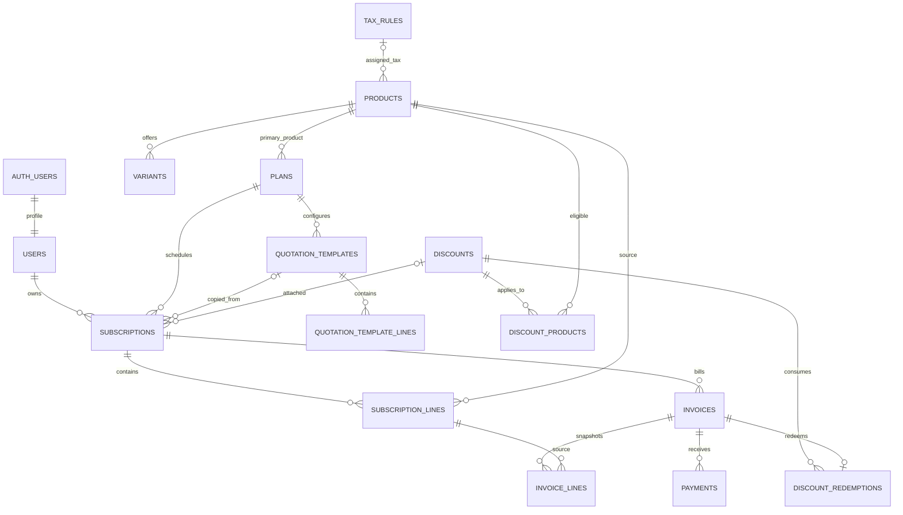

# Database schema and migrations

## Authority and conventions

The SQL in `supabase/migrations` is the executable source of truth. D1 owns this
directory and generated `src/lib/supabase/database.types.ts`. PostgreSQL 17 is the
local target. Supabase supplies `auth.users`, `auth.uid()`, `anon`, `authenticated`
and the server-only `service_role` (which bypasses RLS). Do not reproduce the Auth
schema in migrations or store application passwords. The test-only embedded
PostgreSQL environment emulates those Auth objects; it is not a replacement for
checking the real Supabase stack before release.

All application IDs are UUIDs. References use `ON DELETE RESTRICT`; financial
history must not disappear through cascading deletes. Mutable root entities have
`created_at`, `updated_at`, `version` (starts at 1; an update trigger increments it
and preserves creation time). Child rows have `created_at`; mutate draft children
and advance their parent's version in the same transaction. Receipts/redemptions
are append-only. Retire configuration using `is_active`, close subscriptions and
cancel invoices instead of deleting them.

Money columns are `bigint` minor units. Unit prices/costs are 0..9,000,000,000,000;
invoice header amounts and receipts are capped at 9,000,000,000,000,000 per input
amount. Quantities are 1..1,000,000. API values for all bigint fields are decimal
strings, including `version`. Currency is uppercase three letters. Services must
validate supported currencies and aggregate overflow; the regex alone is not an
ISO currency registry. Percentages use basis points 0..10000. All instants are
`timestamptz`; calendar-only availability/tax/due fields are `date`. Use UTC.

## Relationships



## Tables

Unless noted, listed fields are required; `?` means nullable. Common timestamps,
version and `is_active` are described above. See SQL for defaults and checks.

| Table / owner | Domain columns and relationships |
|---|---|
| `users` / D1 | `id -> auth.users`, `display_name`, `role` = admin/internal/customer, `is_active`. Auth owns email; email is not duplicated in public tables. Billing identity/address is captured in invoice snapshot when issuing. |
| `tax_rules` / D2 | `name`, `rate_bps`, `starts_on`, `ends_on?`, `is_active`. Product selects one exclusive tax rule; none means zero tax. Dates inclusive. |
| `products` / D2 | `name`, `product_type` = software/service/addon, `sales_price_minor`, `cost_price_minor`, `currency`, `notes`, `tax_rule_id?`, `is_active`. Cost and notes are internal. |
| `variants` / D2 | `product_id`, `name`, object `attributes`, signed `price_adjustment_minor`, `is_active`. Unique name per product; composite `(id, product_id)` supports belonging checks. |
| `plans` / D2 | `product_id`, `name`, `price_minor`, `currency`, `billing_interval` = daily/weekly/monthly/yearly, `min_quantity`, `available_from`, `available_until?`, `auto_close`, `allow_close`, `allow_pause`, `allow_renew`, `is_active`. Availability inclusive, checked at quote/confirmation; accepted subscriptions persist after a plan is retired. |
| `discounts` / D2 | Unique uppercase `code`, `name`, `scope` = product/subscription, `kind` = fixed/percentage, `amount_minor?`, `currency?`, `percent_bps?`, `min_quantity`, `min_subtotal_minor`, `starts_at`, `ends_at?`, `max_uses?`, `is_active`. Fixed requires amount/currency and no percentage; percentage requires percentage and no amount. A positive minimum purchase requires currency. End is exclusive. Null max uses = unlimited. |
| `discount_products` / D2 | Composite PK `(discount_id, product_id)`. Nonempty mapping required by the service for product-scoped discounts; subscription-scoped rules must have no mapping. |
| `quotation_templates` / D3 | `name`, `plan_id`, `valid_days` (1..3650), `payment_terms_days` (0..365), `is_active`. Only admins configure templates; internal staff consume them. |
| `quotation_template_lines` / D3 | `template_id`, `product_id`, `variant_id?`, `quantity`, `is_primary`. At most one primary line via partial unique index; exactly one required before use. No hardcoded copied prices in template. |
| `subscriptions` / D3 | Unique `number`, `customer_id -> users`, `plan_id`, `template_id?`, `discount_id?`, unique `renewed_from_id?`, `currency`, `status`, `start_at`, `expires_at`, `quote_expires_at?`, `payment_terms_days`, `billing_anchor_at?`, `next_billing_at?`, `closed_at?`, `created_by -> users`, `request_key`, immutable SHA-256 `request_fingerprint`. Unique `(created_by, request_key)` makes creation/renewal retries safe. Expiry must be after start; renewal cannot refer to self. |
| `subscription_lines` / D3 | `subscription_id`, `product_id`, `variant_id?`, `description`, `variant_label?`, `quantity`, `unit_price_minor`, `is_primary`. Snapshots accepted commercial terms; at most one primary, exactly one before quotation. Variant/product composite FK prevents mismatches. |
| `invoices` / D4 | Unique `number`, `subscription_id`, `customer_id`, `currency`, `status`, `period_start/end`, `issued_at?`, `due_on`, `sent_at?`, object `customer_snapshot`, `subtotal_minor`, `discount_minor`, `tax_minor`, generated `total_minor`. Unique `(subscription_id, period_start)` applies even to cancelled invoices. Composite FK matches subscription customer/currency. |
| `invoice_lines` / D4 | `invoice_id`, `subscription_line_id`, `description`, `variant_label?`, `quantity`, `unit_price_minor`, `discount_minor`, `tax_rule_id?`, `tax_rate_bps`, `tax_minor`, generated `amount_minor`. Unique `(invoice_id, subscription_line_id)`. No live joins for printed descriptions/prices. |
| `payments` / D4 | `invoice_id`, `customer_id`, `currency`, positive `amount_minor`, `method` = bank_transfer/cash/card/other, `paid_at`, `note`, globally unique `external_reference?`, `recorded_by -> users`, `request_key`, immutable SHA-256 `request_fingerprint`. Composite FK matches invoice owner/currency; unique `(recorded_by, request_key)`. `note` is customer-visible receipt text, never a private reconciliation memo. No card numbers/CVV/provider payloads. |
| `discount_redemptions` / D4 | `discount_id`, unique `invoice_id`, positive `amount_minor`. Immutable usage ledger; one use per invoice. D4 writes it only through the confirmation transaction designed with D2. |

`invoice.total_minor = subtotal_minor - discount_minor + tax_minor` and
`invoice_line.amount_minor = quantity * unit_price_minor - discount_minor + tax_minor`
are stored generated columns. Outstanding is total minus sum of recorded payments;
do not create a second manually editable balance. Staff create UUID-based human
numbers (`SUB-<uuid>` / `INV-<uuid>`) in the initial implementation; sequence/legal
invoice-number rules need a separate reviewed requirement.

## Security and integrity boundary

Migration 1 creates all 15 tables, constraints and indexes inside a transaction,
enables RLS and revokes client/server grants before commit. Migration 2 installs
policies, explicit privileges and private helpers in a separate transaction. A
failure between migrations leaves data inaccessible to API roles. The only
`SECURITY DEFINER` helpers are in unexposed `private`, fully qualified with empty
`search_path`: a zero-argument role lookup and the Auth insert trigger. Bootstrap
always uses the default customer role, ignores role metadata, and backfills prior
Auth users without changing existing profiles. Public signup cannot choose staff.

Authenticated users get SELECT only; policies in architecture.md restrict rows.
There are no client insert/update/delete grants, including for admins. Service
role gets read plus insert/update on mutable entities, draft-child DML, and only
INSERT on payments/redemptions; it gets no root-entity delete privileges. Do not
grant broader privileges as an implementation shortcut. Trigger execution itself
does not require exposing trigger functions as callable RPCs.

Database guarantees now: FK existence/variant belonging, invoice/payment owner and
currency continuity, allowed state values, nonnegative/bounded amounts, valid
periods, at most one primary line, unique numbers/periods/retry keys, retained
history, RLS and current-role lookup. Service/RPC guarantees required before
feature release: status edges, plan/product currency match, exactly one matching
primary line, positive adjusted prices, aggregate totals, matching invoice source
subscription lines, immutable issued content, discount limits, overpayment and
all role/action gates. These cannot be claimed from a `CHECK` or RLS alone.

RLS is a read boundary; service-key writes are trusted server operations. Add each
transactional RPC and its integration tests as a new migration. Do not expose
financial mutation routes until those transactions exist. Default Supabase grants
for future objects are not changed globally here: every future migration must
explicitly enable RLS and revoke/grant only its own new objects in the same
transaction. Views must use `security_invoker = true` or remain private.

## Query/index plan

FKs have leading indexes or unique/PK indexes. Operational indexes cover customer
subscription/invoice lists, active `next_billing_at`, confirmed invoice `due_on`,
payments by customer/date, and discount usage count. Owner policies on child rows
use indexed parent joins. Avoid OFFSET at large depths; use stable keyset order
`created_at DESC, id DESC` (payment history uses `paid_at DESC, id DESC`). Examine
`EXPLAIN (ANALYZE, BUFFERS)` on realistic fixtures before adding redundant indexes.

## Expand, migrate, verify, contract

Current readers: only the starter UI (no database calls). Current writers: none.
New readers: user JWT under RLS and authorized server services. New writers:
Auth bootstrap plus future owned server transactions. Initial schema is empty;
Auth backfill is the only data migration. No existing tables/rows are dropped.
Confirm a target is new before applying: an existing `public.users` or another
same-named table is a conflict, not permission to overwrite it. An initial
collision fails atomically for investigation.

Local setup (CLI 2.122.0, Docker required):

```sh
supabase start
supabase db reset --local
supabase db query --local --file supabase/tests/initial-schema.sql
supabase db lint --local
supabase db advisors --local
supabase migration list --local
```

`db reset --local` is only for disposable local databases. The SQL test runs in a
transaction and rolls back fake fixtures. Do not run it against production. Do
not put a credentialed DB URL in committed commands. Hosted migration is a
separate, explicitly authorized operation: D1 checks project identity, backs up,
reviews `supabase db push --dry-run`, applies `supabase db push`, verifies migration
history and tests with safe test accounts. Never use `db reset` on a shared DB.

For each later change:

1. Fetch latest main; agree with D1 on a single migration owner and dependency.
   Generate a fresh ordered filename using `supabase migration new <name>`.
   Never edit/rename an applied file, use `IF NOT EXISTS` to hide schema drift,
   or repair migration history to conceal an error.
2. **Expand:** add nullable/defaulted columns or new tables/indexes and explicit
   RLS/grants. Keep old columns/RPC signatures usable by the old application.
3. **Migrate:** deploy dual-compatible readers/writers when needed, backfill in
   bounded, restartable batches using a predicate such as `new_column IS NULL`.
   Record progress/counts and failures. Lock only the rows that must serialize.
4. **Verify:** fresh database reset plus upgrade from the prior revision with
   fixtures; compare row counts, snapshot amounts, constraints, grants, RLS and
   old/new app behavior. A rename is add/copy/switch, not immediate drop/rename.
5. **Contract:** only after every deployed consumer and scheduled job has moved
   and the rollback window is closed, propose a separate authorized migration to
   remove obsolete objects. Destructive contraction is never implicit.

Mixed versions may overlap from expansion through verification. Prefer additive
fields and optional response keys; never change money units, state strings or RPC
argument meaning in place. A transaction failure rolls back its migration; stop
deployment, inspect logs/history and retry only unapplied work after correction.
Supabase migration history tracks once-only execution; SQL is not intended to be
manually reapplied. Unique business/retry keys protect workflow retries separately.

Rollback: before data is written, stop the rollout and fix forward with a new
migration; a disposable local database may be recreated. After data exists,
roll back application code to the compatible version and retain expanded schema.
Do not supply/run a destructive down migration that drops financial data. Recovery
from actual corruption uses an operator-approved backup/PITR restoration into a
separate database, reconciliation and controlled cutover. This commit performs
only expansion; it does not migrate a hosted project or perform contraction.

## Verification record

### D1 identity expansion

`20261031060015_identity_transactions.sql` adds server-only profile/access RPCs,
a private invitation ledger and Auth capture trigger. Every identity mutation
takes the same transaction advisory lock before user row locks and rechecks the
active actor. Access changes compare the expected version; a trigger prevents
removing the last active admin. The service-role-only RPCs are SECURITY INVOKER;
the private Auth lookup/capture helpers are narrowly granted SECURITY DEFINER
because Auth schema reads/trigger writes have no ordinary service-role grants.
They use an empty search_path and never accept role metadata as authorization.

Invitation preparation refuses existing Auth accounts, leases one normalized
email for two minutes and persists the claim. New Auth users still bootstrap
as customers. Completion requires a captured user with Auth's server-owned
invited_at, the matching claim and a still-active admin. Failure leaves customer
permissions; a retry reconciles a created user instead of resending. Accepted
retries cannot reverse later access changes. No failed invite deletes an account.
The ledger retains pending attempts/timestamps for diagnosis. Application rollback
retains this additive schema and the existing baseline tables/signatures.

The rollback-only `supabase/tests/identity.sql` exercises success, stale versions,
role denials, inactive users, last-admin protection, retries, signup races and
revoked inviters against real Supabase. The baseline suite still passes after
the expansion. Both public and private database lint pass.

`20261031062224_require_invitation_claim.sql` tightens completion to require a
non-null claim and live lease. Released claims cannot be completed with null.
The prior applied migration remains unchanged; the regression runs on the
upgraded database with the same pending invitation shape and RPC signature.

The committed SQL self-check exercises real PostgreSQL constraints and role-based
access, including metadata escalation, two customers, internal/admin reads,
disabled-account access, repeat billing/payment keys and financial retention.
During baseline authoring it is also run on a temporary PGlite PostgreSQL engine
with a minimal Auth/role shim. Docker/Supabase services are unavailable on the
authoring machine, so real Auth email/password flows, PostgREST behavior and
Supabase advisors remain required D1 release checks. Typecheck, lint and build
results are reported with the baseline delivery, separately from database tests.

Authoring evidence: 45 SQL assertions passed. Additional disposable-instance
checks passed for fail-closed privileges between migrations, backfilling a prior
Auth user as customer despite role metadata, and preserving existing table/data
when a schema name collides (the migration fails atomically). TOML parses and
local CLI accepts the config. In a clean isolated checkout with `npm ci`,
`npm run typecheck`, `npm run lint` and `npm run build` all pass. The original
working copy had a local Turbopack CSS-worker failure; the clean checkout built
successfully with the same source, Next configuration and dependency lockfile.
No application/dependency changes were required. Local database lint cannot
connect without the Supabase/Docker stack and is not reported as passed.
